# Welcome to PANKEGG!


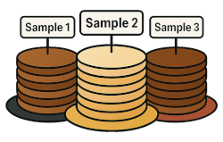

Welcome to the Pankegg documentation. Here you will find all the information you need to get started with Pankegg.

The paper: [](https://doi.org/10.21105/joss.09188)
The Zenodo archive: [](https://doi.org/10.5281/zenodo.17963072)

## Overview
 
*A powerful parser and visualizer for metagenome bin annotation, classification, and quality assessment.*

Pankegg is a flexible and user-friendly interactive software suite built with Python, SQL, Jinja, JavaScript, and Flask, designed to visualize and compare bin annotations, taxonomic classifications, and quality metrics (estimated by CheckM2). It enables interactive exploration and comparison of results across bins and samples through a local web server interface.

Pankegg is ideal for anyone working with output files from CheckM2, EggNOG, Sourmash, or GTDB-TK. While it can be integrated into any workflow, it was originally conceived as the final step of the [MUFFIN pipeline](https://github.com/RVanDamme/MUFFIN) to provide a comprehensive visualization and analysis platform.

## Mission Statement

Pankegg aims to provide a comprehensive tool for the analysis and visualization of metabolic pathways across various samples and bins.  
Our goal is to facilitate research and understanding in the field of metagenomics and bioinformatics.


## Features and Benefits

- Compare samples and bins with ease
- Visualize taxonomic compositions
- Analyze pathway completions
- Export data for further analysis

# Table of Contents

- [Getting started](#getting-started)
  - [Install Pankegg and
    Dependencies](#install-pankegg-and-dependencies)
  - [Download Example Test Data
    (optional)](#download-example-test-data-optional)
  - [Build the SQL Database
    (optional)](#build-the-sql-database-optional)
  - [Launch the Web Application](#launch-the-web-application)
  - [Open web browser](#open-web-browser)
  - [Input files](#input-files)
  - [Bin names](#bin-names)
  - [Additional Input Files Provided by
    Pankegg](#additional-input-files-provided-by-pankegg)
- [Installation](#installation)
  - [Install from PyPI or Bioconda](#install-from-pypi-or-bioconda)
  - [Install PANKEGG from the
    repository](#install-pankegg-from-the-repository)
    - [Download via wget or curl](#download-via-wget-or-curl)
    - [Clone via git](#clone-via-git)
  - [Install dependencies](#install-dependencies)
    - [Using conda](#using-conda)
    - [Using pip](#using-pip)
    - [Using pixi](#using-pixi)
  - [Windows Subsystem for Linux](#windows-subsystem-for-linux)
- [The tools](#the-tools)
  - [Navigation and Search Pages](#navigation-and-search-pages)
  - [Feature Pages](#feature-pages)
  - [Input file format](#input-file-format)
    - [Classification inputs](#classification-inputs)
    - [Bin names](#bin-names-1)
    - [Create the input file](#create-the-input-file)
  - [Parameters Make DB](#parameters-make-db)
  - [Output Make DB](#output-make-db)
  - [Using pankegg_make_db in a
    pipeline](#using-pankegg_make_db-in-a-pipeline)
  - [Run with Testdata](#run-with-testdata)
    - [Download the test data archive from
      OSF:](#download-the-test-data-archive-from-osf)
    - [Unzip the archive:](#unzip-the-archive)
    - [Create a test database for Sourmash
      classification:](#create-a-test-database-for-sourmash-classification)
    - [Create a test database for GTDB-TK
      classification:](#create-a-test-database-for-gtdb-tk-classification)
  - [Troubleshooting](#troubleshooting)
  - [Input file](#input-file)
  - [Usage APP](#usage-app)
  - [Parameters APP](#parameters-app)
  - [Output APP](#output-app)
  - [Run with Testdata](#run-with-testdata-1)
  - [Troubleshooting](#troubleshooting-1)
- [Web Interface](#web-interface)
  - [Home](#home)
  - [Bin](#bin)
  - [Map](#map)
    - [Filtering and Search](#filtering-and-search)
    - [Viewing KO Details](#viewing-ko-details)
    - [KEGG Info and Pathway
      Highlighting](#kegg-info-and-pathway-highlighting)
  - [KEGG](#kegg)
  - [Taxonomy](#taxonomy)
  - [Sample vs Sample](#sample-vs-sample)
  - [Bin vs Bin](#bin-vs-bin)
  - [Taxonomy Comparison](#taxonomy-comparison)
  - [PCA](#pca)
- [Additional Information](#additional-information)
  - [Reporting Bugs & Contributing](#reporting-bugs--contributing)
  - [Support](#support)
  - [Authors](#authors)
  - [AI and LLM](#ai-and-llm)

# Getting started

<br> This quickstart guide will walk you through setting up Pankegg,
running the pipeline on test data, and launching the web application to
explore your results.

## Install Pankegg and Dependencies

Install Pankegg via pip, conda, or pixi.  
See the [Installation](#installation) section for detailed options.

``` bash
pip install pankegg
```

or, from a copy of the repository:

``` bash
wget https://github.com/RVanDamme/PANKEGG/archive/refs/heads/master.zip
unzip master.zip
cd PANKEGG-master
pip install .
```

## Download Example Test Data (optional)

Download and extract the example dataset:

``` bash
wget https://osf.io/download/5v3zc/ -O pankegg_test_data.zip
unzip pankegg_test_data.zip
```

## Build the SQL Database (optional)

Generate a Pankegg database from the provided CSV using the included
test data (for both Sourmash and GTDB-TK classification):

``` bash
pankegg_make_db -i pankegg_test_data/sourmash_example.csv -o test_sourmash --output_dir pankegg_test_data
```

## Launch the Web Application

First, generate the secret key to protect your Flask session:

``` bash
python3 -c "import secrets; print('FLASK_SECRET_KEY=' + secrets.token_hex(32))" > .env
```
This ".env" file needs to be in the directory where you start `pankegg_app` (or one of its parent directories, or the PANKEGG dir).

Start the web server using the example database installed with Pankegg:

``` bash
pankegg_app
```

or use the database you generated in point 3:

``` bash
pankegg_app --d pankegg_test_data/test_sourmash.db
```

## Open web browser

Now, open your web browser and go to the IP address written in your
terminal ( <http://0.0.0.0:5000>) to interactively explore your
metagenomic data!

<br>
Pankegg was developed to integrate output files from a variety of metagenomics tools, such as CheckM2, Sourmash, GTDB-TK and EggNOG. You can combine them all, or only add the ones that are interesting for you.

## Input files

| Tool      | Input File | Data Extracted |
|-----------|--------------------------|---------------|
| CheckM2   | quality_report.tsv       | Bin completeness and contamination              |
| Sourmash `tax genome` | \*.classifications.csv (`--output-format csv_summary`) | Bin name (`query_name`), status and taxonomic lineage |
| Sourmash `lca classify` | \*.csv or \*.txt     | ID, status and taxonomic classification         |
| GTDB-TK   | \*.summary.tsv           | User genome and taxonomic classification        |
| EggNOG    | \*.emapper.annotations (raw emapper output) or \*.annotations.tsv (stripped) | KEGG Orthologs, KEGG Pathways, GO terms, Description  |

Supported input files

Each sample uses one classification tool. `pankegg_make_db` recognises the format from the file header, or you can name it with `--classification`. A bin that has no classification (for example because sourmash found no match and wrote no file for it) is stored as unclassified.

## Bin names

The same bin must have the same name in the annotation file name, the CheckM2 `Name` column and the classification file. PANKEGG removes these suffixes before comparing names:

- from annotation file names: `.emapper.annotations`, `.annotations.tsv`, `.annotations`
- from any bin identifier: `.fa`, `.fna`, `.fasta`, each optionally followed by `.gz`

Dots inside a name are kept. For example `S3.439.emapper.annotations`, a CheckM2 `Name` of `S3.439` and a sourmash `query_name` of `S3.439` (or an ID of `S3.439.fa.gz`) all refer to the bin `S3.439`, and `SemiBin_12.emapper.annotations` is the bin `SemiBin_12`. Bin names only need to be unique within a sample.

## Additional Input Files Provided by Pankegg


PANKEGG requires more input files. However, these are already provided and you don't need to worry about them. They are installed with the package, in the `pankegg/data` directory.

| File Name               | Description                                                                   | Data Origin                             |
|-------------------------|-------------------------------------------------------------------------------|-----------------------------------------|
| kegg_map_info.tsv       | Contains mapID, pathway name, and total number of orthologs per pathway (map) | Extracted from KEGG pathway database    |
| kegg_map_orthologs.tsv  | Contains mapID, pathway name, and list of orthologs per pathway (map)         | Extracted from KEGG pathway database    |
| ko.txt                  | Contains the IDs and names of orthologs                                       | Extracted from KEGG orthologs database  |
| pathway.txt             | Contains map IDs (pathways) and their names                                   | Extracted from KEGG pathway database    |
| pathway_groups.txt      | Maps IDs grouped by KEGG sub-categories                                       | Extracted from KEGG pathway database    |

Additional input, built into PANKEGG

# Installation

<br>

## Install from PyPI or Bioconda

From version 2.1.0, Pankegg is distributed as two packages. Install
**one** of them:

| Package | Contains | Dependencies |
|----|----|----|
| `pankegg` | `pankegg_make_db` and the web app `pankegg_app` | Flask, pandas, NumPy, scikit-learn, SciPy, … |
| `pankegg-makedb` | `pankegg_make_db` only, for pipelines and containers | none (Python standard library) |

Pankegg packages

``` bash
pip install pankegg                       # everything
pip install pankegg-makedb                # database builder only

conda install -c conda-forge -c bioconda pankegg          # everything
conda install -c conda-forge -c bioconda pankegg-makedb   # database builder only
```

Both packages provide the same `pankegg` Python package, so do not
install both in the same environment. Python 3.9 or newer is required;
Python 3.13 is recommended.

## Install PANKEGG from the repository

Installing Pankegg from source is simple. You can either download the
repository as a zip file, or clone it using git.

### Download via wget or curl

You can download the repository as a zip file with `wget`:

``` bash
wget https://github.com/RVanDamme/PANKEGG/archive/refs/heads/master.zip
unzip master.zip
cd PANKEGG-master
```

Or with `curl`:

``` bash
curl -L https://github.com/RVanDamme/PANKEGG/archive/refs/heads/master.zip -o master.zip
unzip master.zip
cd PANKEGG-master
```

**OR**

### Clone via git

Alternatively, you can clone the repository directly using git:

``` bash
git clone https://github.com/RVanDamme/PANKEGG.git
cd PANKEGG
```

## Install dependencies

You can install Pankegg and all necessary dependencies via **conda**,
**pip**, or **pixi**.

### Using conda

For a stable installation, use
[conda-lock](https://github.com/conda/conda-lock) to create and activate
a stable conda environment using the provided `conda-lock.yml` file
(found in the `conda.recipe` directory):

``` bash
conda-lock install --name pankegg_env conda-lock.yml
conda activate pankegg_env
```

Alternatively, create and activate a new conda environment using the
provided `environment.yml` file (found in the `conda.recipe` directory):

``` bash
conda env create -f environment.yml
conda activate pankegg_env
```

### Using pip

From within the repository folder, install Pankegg with all
dependencies by running:

``` bash
pip install .
```

To build the light `pankegg-makedb` package (database builder only, no
dependencies) from the repository instead:

``` bash
python tools/build_makedb.py
pip install dist/pankegg_makedb-*.whl
```

For development (editable install with the test dependencies):

``` bash
pip install -e ".[dev]"
pytest                 # offline tests
pytest --run-osf       # also compare with the OSF example data (needs network)
```

### Using pixi

If you use [pixi](https://prefix.dev/docs/pixi/), you can use the
`pixi.lock` and run all the Pankegg commands with:

``` bash
pixi run <pankegg_command>
```

Substitube `<pankegg_command>` with the command you want to run.

### Windows Subsystem for Linux

If you are using WSL, you should install Pankegg in the WSL itself and
**NOT on your Windows drive**. This is required because of the disparity
between the Linux FileSystem and the Windows FileSystem, which prevents
the tools from running correctly through WSL when installed in the
Windows FS.

We also recommend storing your database in the WSL rather than on your
Windows drive. While this is not critical, it is a better practice and
ensures that Pankegg will read the database properly.

## Finish the installation and test PANKEGG

Once the installation is complete, you need to generate the secret key to protect your Flask session:

``` bash
python3 -c "import secrets; print('FLASK_SECRET_KEY=' + secrets.token_hex(32))" > .env
```
This ".env" file needs to be in the directory where you start `pankegg_app` (or one of its parent directories, or the PANKEGG dir), and once it's done, it doesn't need to be rerun.


You can now run Pankegg using:

``` bash
pankegg_make_db --version
pankegg_make_db --help
pankegg_app --help
```

(`pankegg_app` is only installed with the full `pankegg` package, not
with `pankegg-makedb`.)

If the commands are not in your PATH, then use the whole path to the
executable. From a copy of the repository you can also run
`python pankegg_make_db.py` and `python pankegg_app.py`.

For more detailed instructions on how to use Pankegg, see the [Usage and
Tests](#usage-and-tests) section.

# The tools

<br>

Pankegg is composed of two main tools:

- **Pankegg Make DB**, the data parser and SQL database creator
  ([Pankegg_make_db.py](docs/Pankegg_make_db.qmd)), which processes a CSV
  file where each line lists the required input files for a single
  sample. It compiles the information from these files into a structured
  SQL database, making downstream exploration fast and efficient, and  
- **Pankegg APP**, the web server for interactive data exploration
  ([Pankegg_app.py](docs/Pankegg_app.qmd)), which uses the database generated
  by the parser and provides an interactive browser-based interface to
  explore your results.

The web interface is divided into two main categories:

- **Navigation and Search:** Effortlessly browse and filter all
  available data to find exactly what you need.
- **Features:** Visualize data, compare bins or samples, and generate
  insightful plots.

### Navigation and Search Pages

| Page Name | Usage | Possible Filters |
|----|----|----|
| Bins | Visualize all bins for each sample, review CheckM2 quality and classifications. Generate quality plots, see maps/KEGGs for bins. | Sample Name, Bin Name, Taxonomy, Maps, KEGGs |
| Maps | Visualize all pathways detected in your data, check pathway “completeness”, highlight orthologs present per pathway. | Sample Name, Bin Name, Taxonomy, Map (ID/Name), KEGGs |
| KEGGs | List all KEGGs present globally or in a specific bin; find patterns in ortholog/bin names. | Ortholog Name Pattern, Bin Name (via Bins page) |
| Taxonomy | View tables for each taxonomic rank, listing taxa found and their abundance. | Taxonomic Rank |

Navigation and Search Pages

## Feature Pages

Pankegg provides multiple interactive features:

- **Sample vs Sample:** Heatmap of selected pathways, scatter plots for
  bin quality, PCA of bins, tables/plots showing KEGGs unique or shared
  between samples/pathways.
- **Bin vs Bin:** Plot and table of KEGGs shared or unique between two
  bins for metabolic pathways.
- **Taxonomic Comparison:** For a given rank, see sample-wise
  composition plots (abundance = number of bins classified as taxon /
  total bins), and pathway-vs-taxa heatmaps.
- **PCA:** Dedicated page for visualizing principal component analysis
  (PCA) of each sample, based on KOs, maps, or taxonomy.

> **Note:**  
> In this documentation, the terms “map” and “pathway” are sometimes
> used interchangeably. Typically, “map” refers to the KEGG database’s
> map ID (e.g., `map00010`), while “pathway” refers to the biological
> pathway name. Although the KEGG database provides both a pathway ID
> and a map ID, this tool focuses on the map ID, which is generally more
> complete and reliable for referencing metabolic pathways.

<br>

Pankegg’s data parser that constructs the SQL database that is later used in the web application. It is installed as the `pankegg_make_db` command (with both the `pankegg` and the light `pankegg-makedb` package) and needs only the Python standard library.

## Input file format

To create the SQL database, you will need a CSV file listing all your samples and their corresponding input directories or files.
The expected CSV format uses the following header:

```
Sample name,Annotation_dir,classification_dir,Checkm2_dir
```

Each subsequent line represents a sample:

- `Annotation_dir`: the eggNOG-mapper annotation files of the sample, one file per bin. Both the raw file written by emapper (`*.emapper.annotations`, with its `##` header and footer lines) and the stripped `*.annotations.tsv` files of earlier MUFFIN versions are accepted.
- `classification_dir`: the bin classification files, in one of three formats (see below).
- `Checkm2_dir`: the CheckM2 quality report (`quality_report.tsv`, columns `Name`, `Completeness`, `Contamination`).

Every path may be a glob pattern (`*`). Relative paths are resolved from the directory where you run `pankegg_make_db`. See [Bin names](#bin-names) for how the same bin is recognised in the three inputs.

### Classification inputs

| Tool and command | `--classification` | Files | Notes |
|------------------|--------------------|-------|-------|
| `sourmash tax genome --output-format csv_summary` | `sourmash_tax` | `*.classifications.csv` | One or several bins per file. Bin name from `query_name`. `below_threshold` calls are stored with their (partial) lineage. |
| `sourmash lca classify` | `sourmash_lca` | `*.csv`, `*.txt` | One or several bins per file. `nomatch` bins are unclassified. |
| GTDB-Tk | `gtdbtk` | `gtdbtk.bac120.summary.tsv`, `gtdbtk.ar53.summary.tsv` | `Unclassified …` genomes are unclassified. |

Classification inputs

By default (`--classification auto`) the format is recognised from the file header, separately for each sample; files of two different formats in one sample are an error. Every bin that appears in the annotations but in no classification file is stored as unclassified: this is the normal case for a bin without a `sourmash gather` match, for which sourmash writes no file at all. A `classification_dir` pattern whose directory does not exist is an error (usually a typo); files that are not classification files (directories, signatures, logs) are skipped with a warning.

Examples:

- `sourmash tax genome`:
``` bash
    SAMPLE1,/Path/to/SAMPLE1/eggnog/*.emapper.annotations,/Path/to/SAMPLE1/sourmash/*.classifications.csv,/Path/to/SAMPLE1/checkm2/quality_report.tsv
```

- `sourmash lca classify`:
``` bash
    SAMPLE1,/Path/to/SAMPLE1/bin_annotation/*.annotations.tsv,/Path/to/SAMPLE1/sourmash/*,/Path/to/SAMPLE1/checkm2_dir/quality_report.tsv
    SAMPLE2,/Path/to/SAMPLE2/bin_annotation/*.annotations.tsv,/Path/to/SAMPLE2/sourmash/*,/Path/to/SAMPLE2/checkm2_dir/quality_report.tsv
```

- GTDB-TK:
``` bash
    SAMPLE1,/Path/to/SAMPLE1/bin_annotation/*.annotations.tsv,/Path/to/SAMPLE1/gtdb_results/*.summary.tsv,/Path/to/SAMPLE1/checkm2_dir/quality_report.tsv
    SAMPLE2,/Path/to/SAMPLE2/bin_annotation/*.annotations.tsv,/Path/to/SAMPLE2/gtdb_results/*.summary.tsv,/Path/to/SAMPLE2/checkm2_dir/quality_report.tsv
```

### Bin names

PANKEGG matches the same bin across the three inputs by name, after removing these suffixes:

- from annotation file names: `.emapper.annotations`, `.annotations.tsv`, `.annotations`
- from the CheckM2 `Name` and the classification ID: `.fa`, `.fna`, `.fasta`, each optionally followed by `.gz`

Dots inside a name are kept: `S3.439.emapper.annotations`, CheckM2 `S3.439` and a sourmash ID `S3.439.fa.gz` are all the bin `S3.439`; `SemiBin_12.emapper.annotations` is the bin `SemiBin_12`. Bin names only need to be unique within a sample. An annotation file name without one of the suffixes above keeps the naming of PANKEGG 2.0.0 (the first two dot-separated parts) and a warning is printed.

### Create the input file

You can create this input CSV file automatically with a bash loop, depending on how your data are organized. The repository contains ready-made scripts that you can edit: `generate_input_sourmash_tax_by_sample.sh`, `generate_input_sourmash_tax_by_tool.sh` (`sourmash tax genome`), `generate_input_sourmash_by_sample.sh`, `generate_input_sourmash_by_tool.sh` (`sourmash lca classify`), `generate_input_gtdbtk_by_sample.sh` and `generate_input_gtdbtk_by_tool.sh`.


#### If your results are grouped by sample:

``` bash
Dir/
├── SAMPLEID1/
│   ├── bin_annotation/
│   ├── sourmash/
│   ├── gtdb_results/
│   └── checkm2_dir/
└── SAMPLEID2/
    ├── bin_annotation/
    ├── sourmash/
    ├── gtdb_results/
    └── checkm2_dir/
```

Run the following script to include Sourmash annotation:

``` bash
echo "Sample name,Annotation_dir,classification_dir,Checkm2_dir" > samples.csv
for sample in Dir/*; do
    name=$(basename "$sample");
    ann_path="$sample/bin_annotation/*.annotations.tsv";
    class_path="$sample/sourmash/*";
    checkm2_path="$sample/checkm2_dir/quality_report.tsv";
    echo "$name,$ann_path,$class_path,$checkm2_path" >> samples.csv;
done
```

For `sourmash tax genome` results, use `class_path="$sample/sourmash/*.classifications.csv"` (and `*.emapper.annotations` for raw eggNOG-mapper files), or edit `generate_input_sourmash_tax_by_sample.sh`.

Run the following script to include GTDBTK annotation:

 ``` bash
echo "Sample name,Annotation_dir,classification_dir,Checkm2_dir" > samples.csv
for sample in Dir/*; do
    name=$(basename "$sample");
    ann_path="$sample/bin_annotation/*.annotations.tsv";
    class_path="$sample/gtdb_results/*.summary.tsv";
    checkm2_path="$sample/checkm2_dir/quality_report.tsv";
    echo "$name,$ann_path,$class_path,$checkm2_path" >> samples.csv;
done
```

#### If your results are grouped by tool, then sample:

 ``` bash
Dir/
├── bin_annotation/
│   ├── SAMPLEID1/
│   ├── SAMPLEID2/
│   └── ...
├── sourmash/
│   ├── SAMPLEID1/
│   ├── SAMPLEID2/
│   └── ...
├── gtdb_results/
│   ├── SAMPLEID1/
│   ├── SAMPLEID2/
│   └── ...
└── checkm2_dir/
    ├── SAMPLEID1/
    ├── SAMPLEID2/
    └── ...
```

Run the following script to include Sourmash annotation:

``` bash
echo "Sample name,Annotation_dir,classification_dir,Checkm2_dir" > samples.csv
for sample in Dir/bin_annotation/*; do
    name=$(basename "$sample");
    ann_path="Dir/bin_annotation/$name/*.annotations.tsv";
    class_path="Dir/sourmash/$name/*";
    checkm2_path="Dir/checkm2_dir/$name/quality_report.tsv";
    echo "$name,$ann_path,$class_path,$checkm2_path" >> samples.csv;
done
```

For `sourmash tax genome` results, use `class_path="Dir/sourmash/$name/*.classifications.csv"`, or edit `generate_input_sourmash_tax_by_tool.sh`.

Run the following script to include GTDBTK annotation:

``` bash
echo "Sample name,Annotation_dir,classification_dir,Checkm2_dir" > samples.csv
for sample in Dir/bin_annotation/*; do
    name=$(basename "$sample");
    ann_path="Dir/bin_annotation/$name/*.annotations.tsv";
    class_path="Dir/gtdb_results/$name/*.summary.tsv";
    checkm2_path="Dir/checkm2_dir/$name/quality_report.tsv";
    echo "$name,$ann_path,$class_path,$checkm2_path" >> samples.csv;
done
```

## Parameters Make DB

- `-i, --input`
Path to the CSV file listing all samples and their input files/directories (required).

- `-o, --output`
Name of the output database file (**without the extension**). The default is `pankegg`. The `.db` extension is automatically added to the output name.

- `--output_dir`
Directory the database will be written to. The default is `./db_output`.

- `--classification {auto,sourmash_tax,sourmash_lca,gtdbtk}`
Format of the classification files. `auto` (default) recognises it from the file headers; an explicit value that does not match the files is an error that names the files.

- `--gtdbtk`
Same as `--classification gtdbtk`; kept so that existing commands keep working.

- `-q, --quiet` / `-v, --verbose`
Print only warnings and errors / print details for every input file.

- `--version`
Print the version and exit.

All messages are written to the standard error (only `--help` and `--version` print to the standard output). The exit status is 0 on success, 1 when an input or processing error occurred (no partial database is left behind, and an existing database with the same name is kept), and 2 for an invalid command line. The same inputs always give the same database.

## Output Make DB

The output is an SQLite database (`*.db`) that can be opened with tools like `sqlite3`, but is best used with `pankegg_app` for interactive browsing.

The database contains the following tables:

- `taxonomy`
- `bin`
- `map`
- `kegg`
- `bin_map_kegg`
- `bin_map`
- `map_kegg`
- `bin_extra`
- `bin_extra_kegg`
- `sample`
- `pankegg_info` (from 2.1.0: `pankegg_version`, `schema_version`, `classification_methods`)

Each table stores specific information related to bins, pathways, taxonomy, and annotation results for easy querying and visualization.

From 2.1.0 the `bin` table also records how each bin was classified, in `classification_method` (`sourmash_tax`, `sourmash_lca` or `gtdbtk`; empty when the sample had no classification file and `--classification auto` was used) and `classification_status`: the status written by the tool (`match`, `below_threshold`, `nomatch` for `sourmash tax genome`; `found`, `disagree`, `nomatch` for `sourmash lca classify`; `classified` or `unclassified` for GTDB-Tk), or `absent` when the bin had no row in any classification file. Unclassified bins point to a taxonomy row whose ranks are all empty (NULL). Databases made by earlier versions do not have these columns and still open in `pankegg_app`.

## Using pankegg_make_db in a pipeline

The light `pankegg-makedb` package (or its BioContainers image) is enough. Give one CSV line per sample and choose the classification format explicitly:

``` bash
pankegg_make_db -i samples.csv -o pankegg --output_dir . --classification sourmash_tax --quiet
pankegg_make_db -i samples.csv -o pankegg --output_dir . --classification sourmash_lca --quiet
pankegg_make_db -i samples.csv -o pankegg --output_dir . --classification gtdbtk --quiet
```

## Run with Testdata

To verify your installation and familiarize yourself with Pankegg, you can run a test using provided data. Download the example archive, unzip it, and generate test databases using the included CSV files:

### Download the test data archive from [OSF](https://osf.io/wjuet):

``` bash
wget https://osf.io/download/5v3zc/ -O pankegg_test_data.zip
```

OR

``` bash
curl -L -o pankegg_test_data.zip  https://osf.io/download/5v3zc/
```

### Unzip the archive:

This will create a directory called `pankegg_test_data`.

``` bash
unzip pankegg_test_data.zip
```

### Create a test database for Sourmash classification:

``` bash
pankegg_make_db -i pankegg_test_data/sourmash_example.csv -o test_sourmash --output_dir pankegg_test_data
```

### Create a test database for GTDB-TK classification:

``` bash
pankegg_make_db -i pankegg_test_data/gtdbtk_example.csv -o test_gtdbtk --output_dir pankegg_test_data --gtdbtk
```
After running these commands, you should find newly created `test_sourmash.db` and `test_gtdbtk.db` inside the `pankegg_test_data` directory. This is in addition to the already existing `sourmash_example.db` and `gtdbtk_example.db` files in the same directory.

The existing and newly generated databases contain the same samples, bins, taxonomy, quality values and KEGG links. The files are not byte-identical, because 2.1.0 adds the classification columns and the `pankegg_info` table and processes the input files in sorted order. From a copy of the repository you can compare them by content:

``` bash
python tests/regression/summarise_db.py pankegg_test_data/sourmash_example.db > old.json
python tests/regression/summarise_db.py pankegg_test_data/test_sourmash.db > new.json
diff old.json new.json && echo identical
```


## Troubleshooting

For more details or troubleshooting, please consult the [Reporting Bugs & Contributing](reporting_bugs.qmd) section.

<br>

Pankegg’s web server for interactive data exploration.

## Input file

Pankegg_app.py is using the output of
[pankegg_make_db.py](Pankegg_make_db.qmd).

## Usage APP

To start the Pankegg web server with your database, use the following
command (replace with your actual database path):

``` bash
pankegg_app --d /Path/to/YOUR_PANKEGG.db
```

(Replace /Path/to/YOUR_PANKEGG.db with your actual path. From a copy of
the repository, `python pankegg_app.py --d ...` works too.)

> **Note:**  
> Before running the web application, it is highly recommended to
> **set your own Flask secret key**: put `FLASK_SECRET_KEY=<a long
> random value>` in a `.env` file in the directory where you start
> `pankegg_app` (or one of its parent directories, or the repository
> folder), or export
> `FLASK_SECRET_KEY` in your shell. This key is used
> by Flask for session security. Leaving it as the default (‘dev’) is
> fine for local or testing use, but for any real-world or multi-user
> deployment, you should generate and use a strong, unique secret key to
> prevent session tampering and increase security.

## Parameters APP

- `--d` or `--db`  
  Path to the SQLite database you want to browse.  
  Example: `--d /Path/to/YOUR_PANKEGG.db`

- `--help`  
  Display a help message with all available options.

## Output APP

By default, the web server will start on your local IP address (host
`0.0.0.0`) and port `5000`.  
Once started, you can access the Pankegg interface in your browser by
navigating to:

<http://0.0.0.0:5000>

You will be able to browse, filter, and visualize all results contained
in your selected database.

## Run with Testdata

You can test the web interface using either the database provided with
the repository, example databases from the test data, or your own
generated databases.  
Here are example commands (replace BASH with the actual commands):

- To run the app on the example database installed with Pankegg
  (`pankegg/data/pankegg.db`, used when `--d` is not given):

``` bash
pankegg_app
```

- To run the app on the example Sourmash test database
  (`pankegg_test_data/sourmash_example.db`):

``` bash
pankegg_app --d pankegg_test_data/sourmash_example.db
```

- To run the app on the example GTDB-TK test database
  (`pankegg_test_data/gtdbtk_example.db`):

``` bash
pankegg_app --d pankegg_test_data/gtdbtk_example.db
```

- To run the app on the Sourmash database you created during the test
  (`pankegg_test_data/test_sourmash.db`):

``` bash
pankegg_app --d pankegg_test_data/test_sourmash.db
```

- To run the app on the GTDB-TK database you created during the test
  (`pankegg_test_data/test_gtdbtk.db`):

``` bash
pankegg_app --d pankegg_test_data/test_gtdbtk.db
```

## Troubleshooting

For more details or troubleshooting, please consult the [Reporting Bugs
& Contributing](reporting_bugs.qmd) section.

# Web Interface

<br>

This is an overview of all the web app pages:

## Home

At the top, a navigation bar provides quick access to all major
sections: Home, Bin, Map, Kegg, Taxonomy, and Visualisation. Each of
these sections links to a page where you can browse detailed information
about your bins, pathway maps, KEGG identifiers, and taxonomic
classifications, or use the different interactive visualisation tools.
The navbar ensures that you can switch between functional modules.

The landing page, `Home`, links to all elements that are also present in
the navigation bar, and provides a short description for each one.
Additionally, it shows the full content of the `Visualisation` page,
Sample VS Sample; Bin VS Bin; Taxonomy comparison; PCA, and briefly
describes each one.

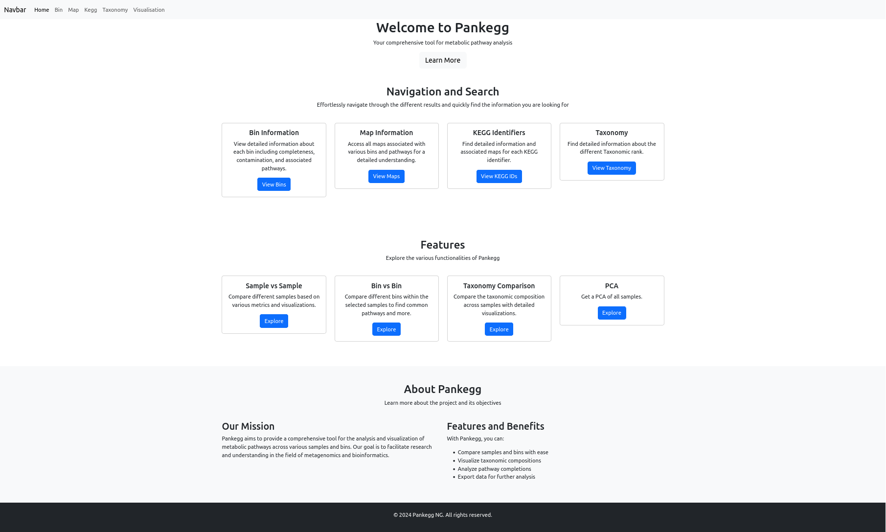

## Bin

The `Bin` information page allows you to view and manage all bins in
your project, organized by sample. At the top, you will find options to
toggle **the visibility** of all bins or all **taxonomy
classifications** with a single click.

A panel provides advanced **sorting, search, and filtering** options: -
**Sort by** Bin Name, Completeness, or Contamination. -
**Filter/search** by sample name, bin name, or any taxonomic rank
(Kingdom, Phylum, Class, Order, Family, Genus, Species). By default the
search is on the sample name and bin name, for filtering by taxonomic
rank select one or more before searching. - **GTDB quality filtering**
can be enabled to display only the bins passing Genome Taxonomy DataBase
selection criteria (completeness - 5\*contamination \>50).

Each bin is displayed in a table below its Sample Name, with columns for
bin name, genus, species, completeness, and contamination.  
For each bin, you can: - **View associated maps (pathways)** or **KEGG
orthologs** with a single click. - **Toggle taxonomy classification** to
expand or collapse the display of detailed taxonomic information. -
**Generate a quality plot** for the bins in a sample.

These features make it easy to explore, filter, and compare bin quality
and taxonomy across all your samples.

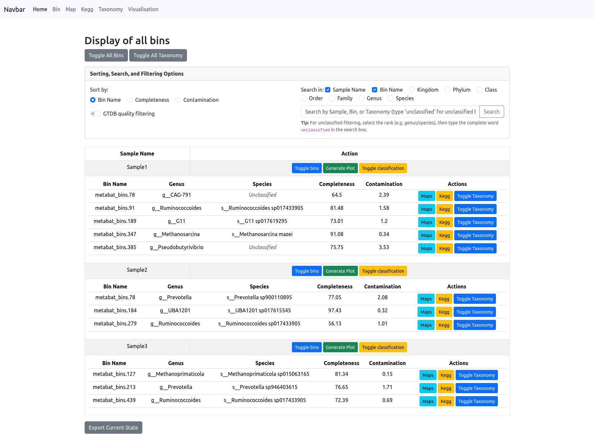

## Map

The `Map` information page gives you an overview of all metabolic
pathways (KEGG maps) present in your dataset. Each pathway is listed
with its map number, pathway name, and a completion percentage, which
indicates the proportion of KEGG orthologs (KOs) found in your data
relative to the total number of KOs for that pathway.

At the top of the page, you’ll find options to toggle all map details
and export your current view. The legend explains how KOs are
visualized:

- **Dark blue**: KEGG ID officially present in the pathway
- **Light blue**: KEGG ID not officially present in the pathway

*Note: Not all KOs contribute equally to pathway function, so this value
is only an approximate indicator.*

### Filtering and Search

You can filter maps by sample, bin, pathway name, or KO identifier using
the controls above the table. When filtering by bin or sample, the
pathway completion percentage is recalculated to only include the KOs
found within the selected bin(s) or sample(s), providing a focused view
of its metabolic potential.

### Viewing KO Details

For each pathway, you can toggle the display of all detected KO IDs.
This expands the row to show the full list of associated KEGG orthologs,
with coloring based on their official status in the pathway.

If you filter through KO IDS, the filtered KO will be highlighted in
orange to differentiate it from all the other KO IDs.

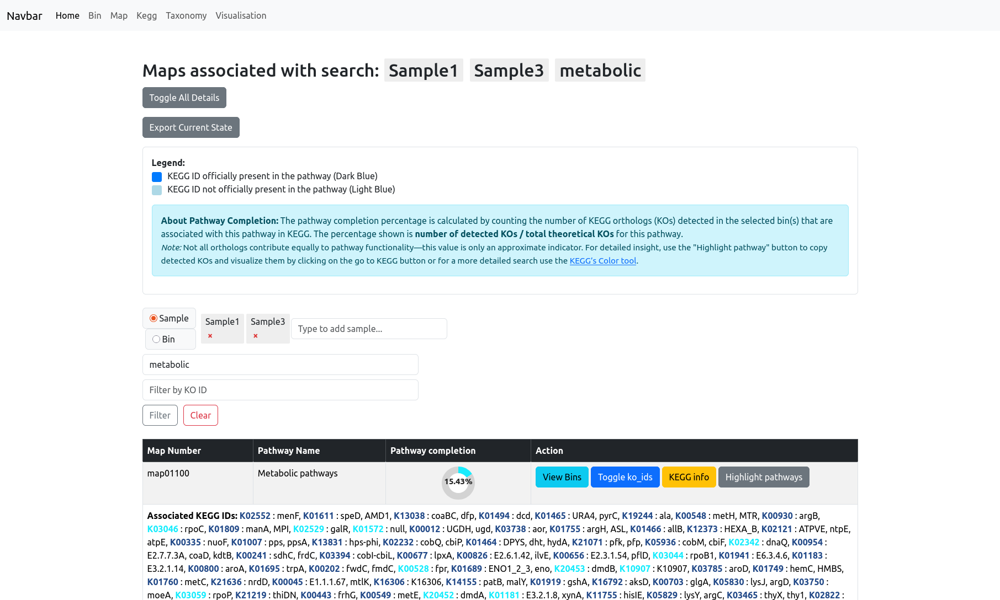

### KEGG Info and Pathway Highlighting

The “KEGG info” button provides a direct link to the pathway’s entry on
the KEGG website for further reference.

The “Highlight pathways” button opens a sidebar slider with all relevant
KO IDs for the selected pathway. You can quickly copy these IDs and use
them in the KEGG color tool to generate a custom view of the pathway map
on the KEGG website. The KOs found in your current data will then be
highlighted with color.

This combination of interactive filtering, KO details, and external
links makes it easy to explore pathway presence, completion, and
functional highlights across all your bins and samples.

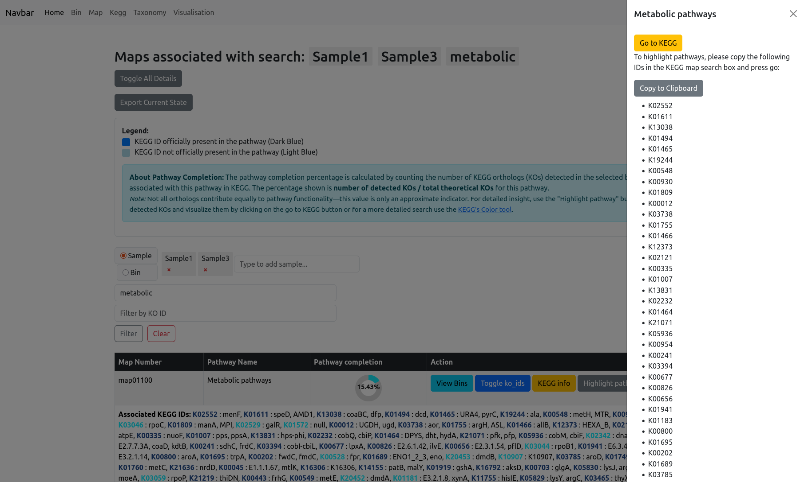

For examples the (Carbon Metabolism
pathway)\[https://www.kegg.jp/pathway/map01200\] for Sample 1 and 3 of
the test data contains:


## KEGG

The `KEGG` page provides an overview of all KEGG orthologs (KO IDs)
detected in your dataset. The main table displays, for each KEGG
ortholog (KO), its ID, KO name, and a full name/description. You can use
the search bar at the top to filter the KEGG IDs.

You see the complete list of KOs across your entire project, with
quick-access buttons to:

- **View Bins:** Show which bins contain the selected KO.
- **View Maps:** See which metabolic pathways (maps) include the
  selected KO.
- **View Details:** Expand to show detailed information for each bin and
  sample in which the KO is present, including associated GO terms and
  EggNOG annotations, if available.
- **KEGG info:** Open the corresponding KO entry on the KEGG website for
  more detailed biological context.

When you apply filters on the `Bin` page, the KEGG Identifiers view will
display only those KOs present in the selected bin, helping you focus on
its functional profile.

Beware that when viewing the details of KOs you can have multiple
entries within the same bin as we parse the entire EggNOG annotation
file and those files can be redundant.

All action buttons are designed for seamless exploration: filter bins
and maps based on any KO of interest, or instantly jump to its external
reference.

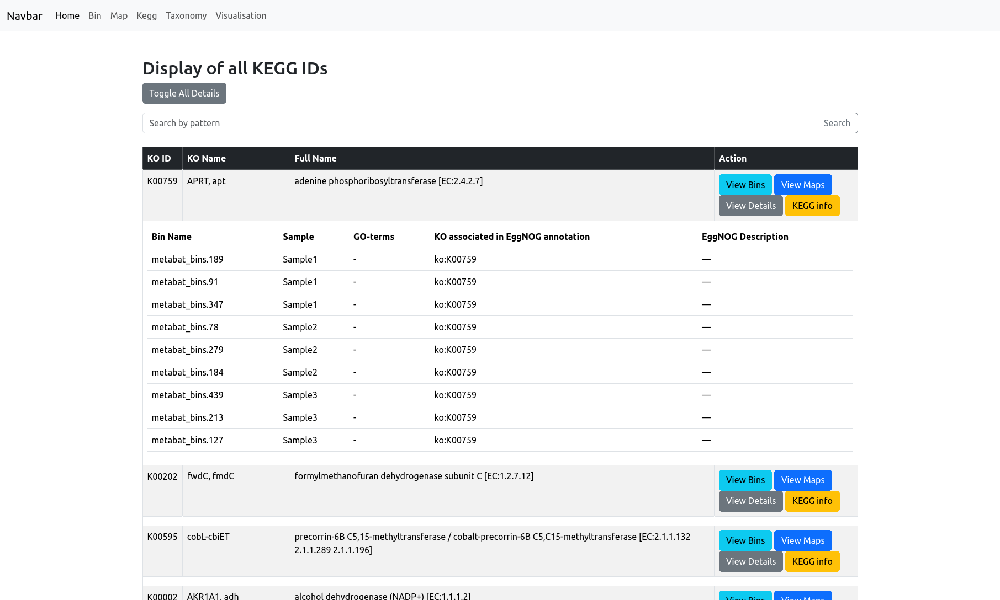

## Taxonomy

The Taxonomy page allows you to explore the taxonomic composition of
your dataset at any rank (such as phylum, class, order, etc.) by simply
selecting the desired taxonomic level from the dropdown menu at the top
of the page. The resulting table lists all taxa detected at that rank,
alongside the number of bins classified under each taxon.

The “unclassified” taxa are qualified in this table as their rank letter
followed by 2 underscore (e.g. S\_\_).

For each taxon, you have quick access buttons to:

- View only the **bins** classified as this taxon,
- See the **maps** (metabolic pathways) found in those bins,
- Browse the **KEGG orthologs** associated with this taxon.

This makes it easy to drill down into the taxonomic groups of interest
and immediately access qualitative and pathway-related information for
any selected group.

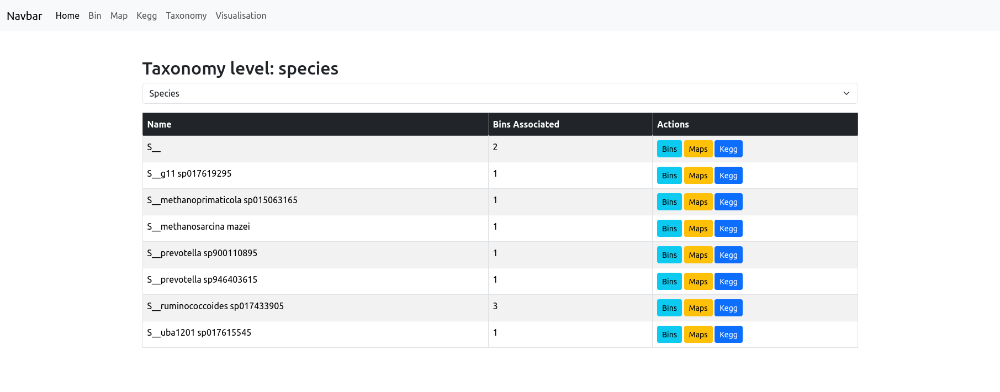

## Sample vs Sample

The Sample vs Sample page enables detailed comparison between any two
selected samples in your dataset.

To begin, choose two samples from the dropdown menus. The page then
displays a suite of visualizations and tables to help you interpret
differences and similarities:

- **Heatmap:**  
  Select a pathway category to visualize completion levels for each bin
  and each pathway in both samples. Pathway completion is shown as a
  heatmap—bins with more complete pathways are colored closer to red,
  while less complete pathways are closer to blue. You can also select
  multiple pathway categories. Each category is plotted individually and
  displayed underneath each other. *Note: Completion is calculated as
  the proportion of orthologs detected in each bin out of the total
  number required for the pathway.*

- **Scatterplot:**  
  The bin quality scatterplot shows, for each sample, the completeness
  versus contamination for all bins, allowing quick assessment of bin
  quality distribution within and between samples.

- **Bin PCA:**  
  PCA (Principal Component Analysis) plots are generated for all bins in
  each sample, displaying the distribution of bins in reduced
  dimensionality space. This highlights similarities or differences in
  bin composition and functional potential. *Note: This should only be
  used if there are sufficient amount of bins provided, a PCA on e.g. 3
  bins has no value*

- **Common Pathways:**  
  A table lists all detected pathways, with counts of shared and unique
  orthologs for each sample. You can filter pathways using the search
  bar. Below, a barplot provides a visual summary of these counts,
  making it easy to spot pathways enriched or unique to each sample.

These combined tools offer a comprehensive, multi-angle comparison of
the functional and taxonomic profiles of your samples.

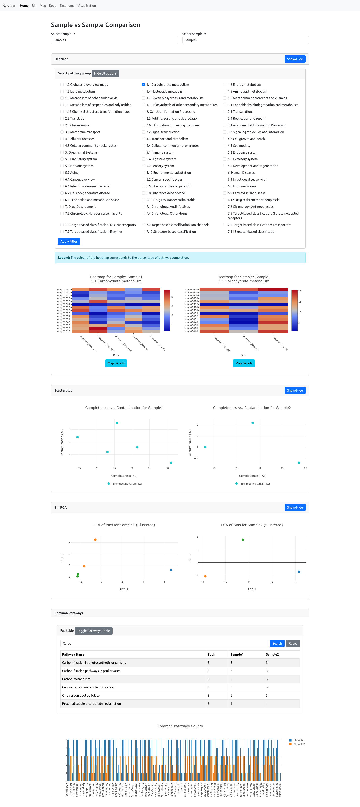

## Bin vs Bin

The Bin vs Bin comparison page allows you to directly compare the
metabolic potential of any two bins, whether they belong to the same
sample or to different samples. After selecting two bins, the page
displays a table listing all metabolic pathways, showing the count of
orthologs detected in both bins, or uniquely in each bin. You can use
the search bar to filter pathways of interest.

Below the table, a barplot visually summarizes these pathway counts,
making it easy to identify pathways that are shared or unique to each
bin.

This focused comparison makes it simple to explore functional
similarities and differences between any two specific genome bins in
your dataset.

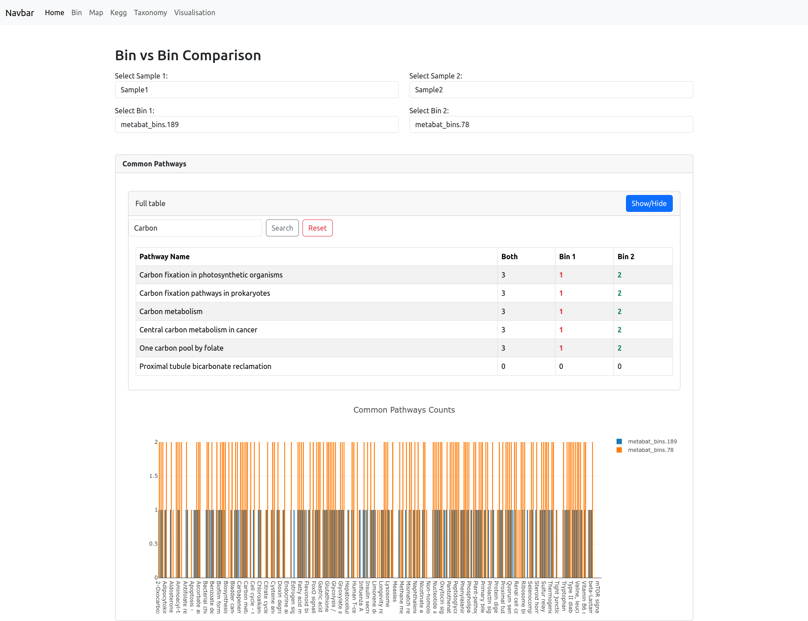

## Taxonomy Comparison

The Taxonomy Comparison page allows you to compare the taxonomic
composition and metabolic potential of your samples at any chosen rank
(such as phylum, class, or order). After selecting a rank, a barplot
displays the percentage of bins belonging to each taxon across all
samples. *Note: The percentages are calculated as the number of bins for
each taxon divided by the total number of bins in each sample.*

Below, a heatmap visualizes the number of bins present at specific
metabolic pathways for each taxon at the selected rank. Pathways (rows)
are compared against taxonomic groups (columns), with color indicating
the number of bins: red signifies higher number of bins, while blue
indicates lower number of bins.

These combined visualizations help you to quickly assess both the
taxonomic structure and functional diversity present in your data.

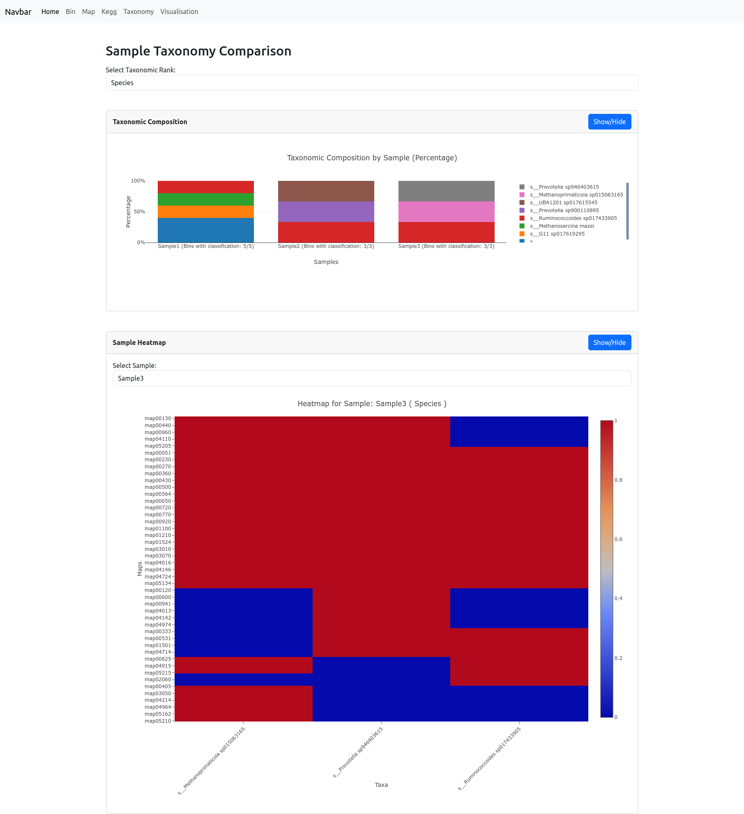

## PCA

The PCA page provides Principal Component Analysis (PCA) visualizations
to help you explore the global structure and relationships in your
dataset. You can choose to perform PCA:

- **Based on KOs:** The samples are differentiated by their KEGG
  Orthologs.
- **Based on Maps:** The samples are differentiated by their metabolic
  pathways (maps).
- **Based on Taxonomy:** The samples are differentiated by their
  taxonomic composition based on the specified rank (such as phylum,
  class, order, etc.).

The resulting PCA plot visualizes your samples in a reduced dimensional
space, helping to highlight patterns, clusters, or differences driven by
functional or taxonomic profiles. The explained variance for the
principal components is displayed below the plot to indicate how much of
the data’s variation is captured. *Note: We recommend using this tool
only if you have enough samples.*

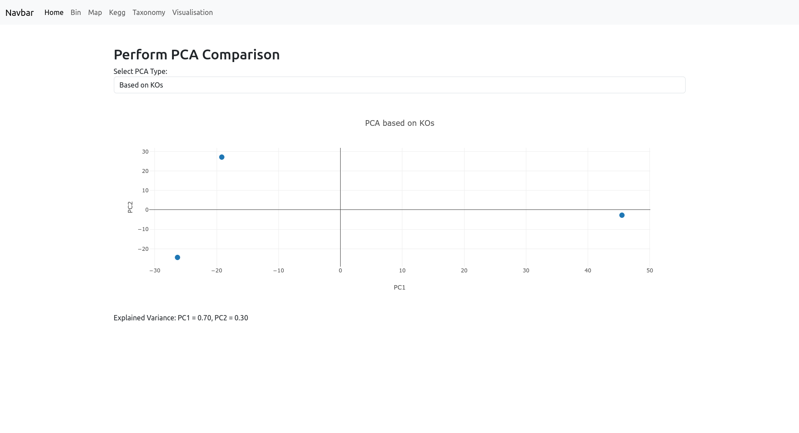

# Additional Information

## Reporting Bugs & Contributing

Contributions from the community are welcome! See the [Contributing
guidelines](CONTRIBUTING.md)

## Authors

<a href="https://github.com/RVanDamme/PANKEGG/graphs/contributors">

</a>

## Support

The development of PANKEGG is supported by the Seydlitz MP Bolagen Foundation through the Seydlitz Laboratory at the Swedish University of Agricultural Sciences.
The development of PANKEGG is supported by the Swedish University of Agricultural Sciences Bioinformatics Infrastructure (SLUBI).

## AI and LLM

AI/LLM were used as “writing buddy” during the redaction of the
README.md (e.g. ensuring a readable markdown structure and correcting
the syntax/grammar). The logic and code were initially made by humans
(@RVanDamme and @Avanbelle), before using AI/LLM on the code to debug
and refactor it.
